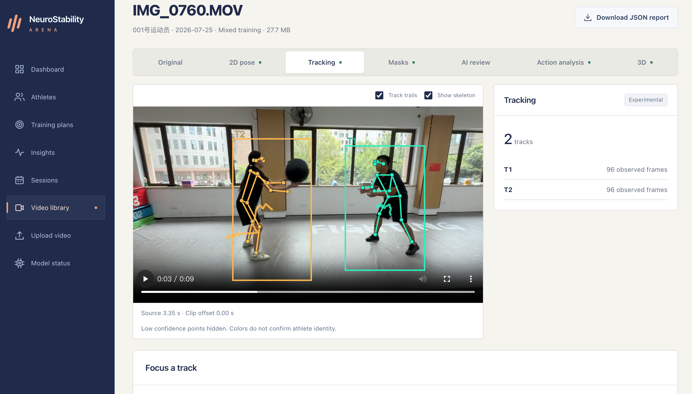
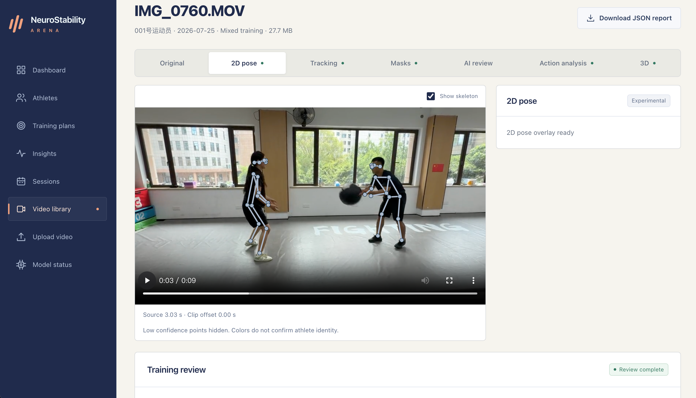
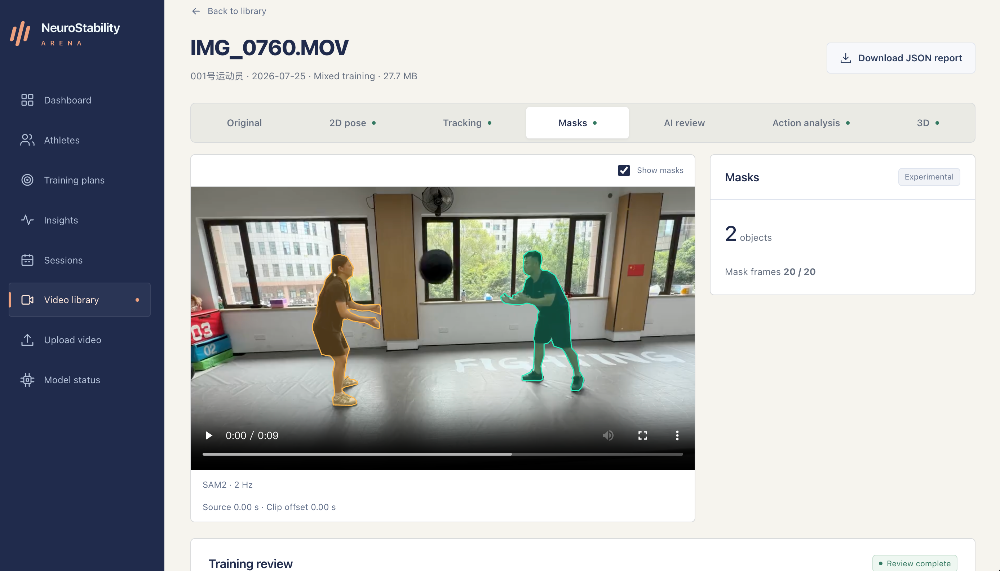
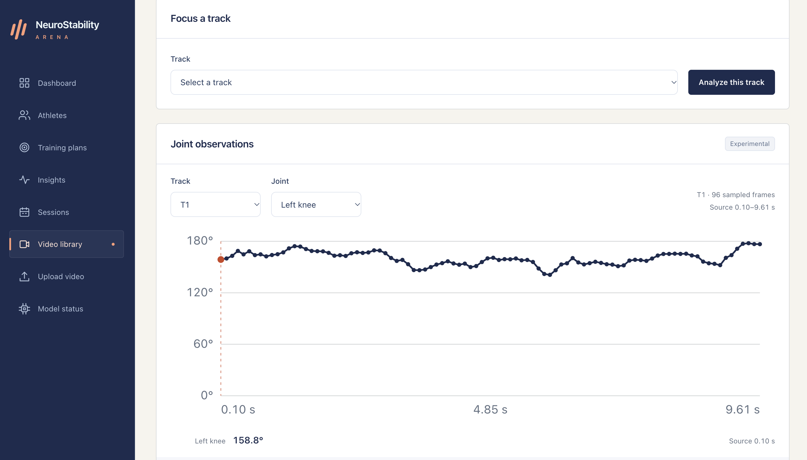
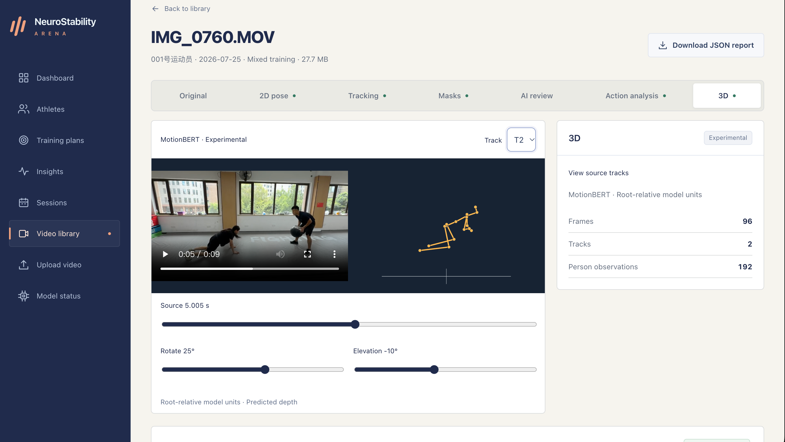
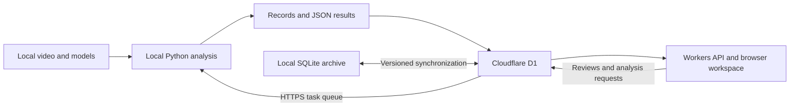

# NeuroStability Arena

**A statistics-centered workspace for digitizing wrestling training and supporting informed coaching decisions.**

[Live workspace](https://neurostability.hedyzheng20090728.workers.dev/) · [Feature preview](#feature-preview) · [Statistical methods](#statistical-methods) · [Run locally](#run-locally) · [Long-term direction](#from-training-records-to-urban-sports-infrastructure)

Training produces video, coaching observations, practice plans, and repeated measurements. NeuroStability Arena connects these records so that a session can be reviewed, summarized, and followed up over time. Freestyle wrestling provides the working setting: rapid movement, close contact, occlusion, and the need to distinguish an athlete from a coach make measurement quality central to the design.

The project combines statistics, computer vision, and sports operations. Existing AI models help extract observations; statistical summaries make their coverage and distribution visible; coaches retain control over classification, interpretation, and training decisions. The longer-term direction is to explore how this approach could support shared data standards for training centers and urban sports facilities.

```text
Record training → Extract observations → Check data quality → Summarize → Review → Plan the next session
```

The online workspace requires an authorized account. The screenshots below can be viewed without signing in.

## Feature preview

These screenshots show the local workspace, where the original video can be played beside or underneath the analysis. The online workspace independently displays synchronized skeletons, trajectories, mask contours, statistics, and review records. Full training videos remain on the analysis computer.

### Person tracking

RTMPose and ByteTrack provide keypoints, bounding boxes, clip-level track identifiers, and image-plane motion trails.



| 2D pose | Person segmentation |
| --- | --- |
|  |  |
| Inspect sampled keypoints and skeletons at source-video timestamps. | Review SAM2 mask contours sampled at 2 Hz. |

| Joint observations | 3D skeleton |
| --- | --- |
|  |  |
| Select a track and joint, inspect its angle sequence, and seek to the corresponding observation. | Select a track, move through saved frames, and rotate the predicted skeleton. |

Track identifiers are local tracking labels and require subject confirmation. The 2D observations depend on the camera view; the 3D skeleton uses root-relative model coordinates. Both retain experimental status.

## Statistical methods

The statistical workflow starts with defining the observational unit and checking the available evidence. Its current scope is descriptive analysis and measurement review, with explicit handling of missing data, repeated observations, and method provenance.

### 1. Observational units and structured variables

The data model separates **athlete → session → video → analysis task → sampled frame**. Training categories are categorical variables; duration is recorded in minutes; perceived exertion and review scores are recorded ratings. These quantities have different meanings and are summarized separately.

A session's recorded duration represents the training session. Archived clip duration represents the available video evidence. A collection of short clips is therefore not used to estimate the duration of the entire session. Repeated analysis attempts are deduplicated by video in analysis summaries, while the full task history remains available.

### 2. Descriptive statistics and empirical distributions

| Method | Implemented use | Interpretation |
| --- | --- | --- |
| Counts and frequencies | Sessions, videos, training categories, events, review status, and sampled-frame quality | Show the amount and composition of recorded evidence. |
| Arithmetic mean | Confirmed review scores, mean trunk angle, and mean ankle span | Describe the included observations under the recorded method or rubric. |
| Median and quartiles | Session duration, recorded RPE, clip duration, and confirmed score distributions | Describe the center and spread of the observed data. |
| Population standard deviation | Horizontal dispersion of the hip midpoint within a sampled clip | Describe variability in the observed image-plane sequence. |
| Minimum, median, and maximum | Per-track knee, elbow, and trunk observations | Summarize each measured sequence while preserving its sample count. |
| Grouped summaries | Date, athlete, training category, and week | Support review of training organization and changes in recorded activity. |

Quartiles use linear interpolation, commonly called **Type 7 quantiles**. For sorted observations indexed from zero, the position for probability $p$ is $h=(n-1)p$, interpolating between the adjacent observations. Empty groups remain missing; a single-observation group returns that observation.

Score summaries use each video's current confirmed review score once. Historical scores remain in the audit trail. Scores are subjective training-clip reviews, and their interpretation depends on the recorded rubric and training context.

### 3. Variability and body-scale normalization

The **Wrestling Stability Engine** implements interpretable image-plane descriptors in [arena/engine.py](arena/engine.py). Let $m$ be the number of usable sampled frames, $x_t$ the horizontal hip-midpoint coordinate, $\ell_t$ the shoulder-midpoint-to-hip-midpoint distance, and $a_t$ the two-dimensional ankle distance.

The normalized hip-midpoint dispersion is:

$$
D_{hip}=\frac{\sqrt{\frac{1}{m}\sum_{t=1}^{m}(x_t-\bar{x})^2}}{\operatorname{median}(\ell_t)}
$$

The normalized mean ankle span is:

$$
S_{ankle}=\frac{\frac{1}{m}\sum_{t=1}^{m}a_t}{\operatorname{median}(\ell_t)}
$$

Using an observed body scale reduces dependence on pixel size under uniform image scaling. It does not correct perspective, camera movement, or differences in technique. The hip midpoint is a geometric landmark, not a measured center of mass. No universal "better" direction is assigned to these descriptors.

The engine also records mean image-plane trunk inclination and per-track joint angles derived from three-point geometry. Formulas, units, timestamps, and method versions accompany the saved results.

### 4. Measurement coverage, missingness, and selection

Sampled frames are partitioned into **usable**, **ambiguous**, and **missing** observations. Usable coverage is the usable-frame count divided by the total sampled-frame count. When combining valid partitions across clips, the system pools counts rather than taking an unweighted mean of clip percentages.

The current pose method uses a keypoint confidence threshold of 0.5 and requires at least 10 usable frames with at least 60% coverage before returning its aggregate descriptors. Acceptance checks also consider ambiguity, subject selection, and finite measurement values. These are software eligibility rules, not a validation of athletic performance.

Missing measurements remain `null` in JSON and blank in CSV; missing RPE is not treated as zero. Gaps in per-track joint sequences are retained without interpolation. Coverage is reported because occlusion and close contact can change which portions of a wrestling clip are measurable. Measurement availability and training-session quality are separate records.

### 5. Temporal dependence and repeated measures

Adjacent frames from the same person are correlated. Clips from one session and repeated sessions from one athlete also share context. Frame counts describe sampling density, not the number of independent participants.

The interface preserves time sequences and supports descriptive comparisons. It does not infer that a change in a plotted value was caused by training. Sampling rate, camera view, selected track, clip interval, and method version remain available when comparing observations. A detector's confidence score is a filtering input, not a probability that a wrestling technique is correct.

### 6. Sports management indicators

Planning and training records support operational statistics in [arena/planning.py](arena/planning.py):

- **Plan completion:** completed due plans divided by non-cancelled due plans, using the reporting cutoff and workspace timezone. A completed plan must link to an actual recorded session.
- **Recorded workload proxy:** $\sum_s d_s r_s$ over sessions with a recorded RPE, where $d_s$ is duration in minutes and $r_s$ is perceived exertion. The system also reports RPE coverage; the result is an arbitrary-unit summary of recorded inputs.
- **Weekly activity:** recorded session counts, minutes, and available workload summaries, grouped by Monday-starting week.
- **Review coverage:** reviewed videos, confirmed scores, and annotation counts, with access to the supporting records.

These indicators connect day-to-day coaching with planning, documentation, and allocation of attention. They are not clinical measures of fatigue or validated measures of competitive ability.

### 7. Reproducibility and further validation

Exports include CSV tables, a data dictionary, formulas, filters, a reporting cutoff, model hashes, and method versions. Review edits retain their source task, account, timestamp, and history. Synthetic development fixtures are excluded from real-training summaries.

The implementation separates three kinds of evidence: a model observation, a person's review decision, and scientific validation. Future statistical work includes annotated reference measurements, repeatability under controlled filming, and agreement between reviewers before introducing inferential comparisons.

Core implementations: [measurement engine](arena/engine.py), [analysis summaries](arena/analytics.py), [planning and exports](arena/planning.py), and the [Cloudflare implementation](cloudflare/src/analytics.ts).

## Training workflow

1. Create an athlete profile and record the session's date, objective, actual duration, and optional RPE.
2. Import authorized clips under **Stability Training**, **Footwork Training**, **Attack Techniques**, or **Defense Techniques**. Mixed training can be recorded and later reclassified.
3. Run an available local backend. Inspect its progress, source timestamps, coverage, and output.
4. Select the intended subject or track, review observations against the local video, and record events or corrections.
5. Save review comments and optional scores. Confirmation and subsequent edits remain traceable.
6. Use the dashboard, athlete profile, filtered statistics, and exports to inform the next training plan.

The interface defaults to English and supports one-click English/Chinese switching. Existing recorded observations retain their original language.

## Models and current scope

The platform integrates existing pretrained models through replaceable backends. It does not require training a new foundation model.

| Component | Role | Current scope |
| --- | --- | --- |
| FFmpeg / FFprobe | Video validation and preprocessing | Checks media properties, supports clip selection, and removes audio from analysis copies. |
| RTMPose + YOLOX | 2D body keypoints and person detection | Local ONNX inference with COCO17 keypoints and recorded model provenance. |
| ByteTrack | Person trajectories | Clip-level track identifiers, motion trails, and explicit track selection for further analysis. |
| SAM2.1 tiny | Person segmentation | Saved mask contours at 2 Hz, using initial person boxes or a selected region. |
| Qwen3-VL | Visual action analysis | Timestamped descriptions and action candidates from sampled video frames; coaches can revise and save events. |
| MotionBERT Lite | 3D skeleton prediction | Root-relative skeletons derived from tracked 2D observations; no calibrated world coordinates or body mesh. |
| Qwen2.5 local review model | Language-assisted review | Selects supported material from saved observations to form traceable review drafts. |
| FSW-Net | Wrestling-specific recognition | A verified trained checkpoint has not been found; no validated inference runner is enabled. |
| WHAM | Optional future 3D backend | Not integrated; requires its own environment, weights, and licensed body-model assets. |

Available backends depend on installed dependencies and verified weights. Wrestling contact and occlusion remain important sources of error. The system does not automatically derive competition points, technique success rates, medical conclusions, or an overall ability score from pose coordinates. See the [RTMPose validation notes](docs/rtmpose-validation.md) and [FSW-Net audit](docs/fsw-audit.md).

## From training records to urban sports infrastructure

Wrestling is the current application, but the broader question concerns the digital infrastructure around sport: how training activity, coaching services, and physical spaces can be recorded consistently enough to support better operations.

A future community training center could keep sensitive video locally while sharing permissioned summaries of sessions, program participation, and service delivery. Comparable definitions and transparent reporting could help facility managers understand demand, organize coaching provision, and evaluate how public sports resources are used.

| Future direction | Foundation in this project | Additional work required |
| --- | --- | --- |
| Facility utilization | Structured sessions, dates, and training categories | Explicit facility, mat/court, booking, and attendance records with clear utilization denominators. |
| Program planning | Training plans, completion records, and weekly summaries | Links between programs, coaches, facilities, and available time slots. |
| Access and participation | Athlete and session relationships | Consented participation records and aggregate reporting to study access across programs and locations. |
| Resource allocation | Traceable activity summaries and exports | Staff-time and capacity data to examine demand by place and time. |
| Program evaluation | Versioned observations and review history | Repeated observations, reference measures, and study designs suited to the evaluation question. |
| Cross-facility reporting | Separate local analysis and online result storage | Shared schemas, permissions, retention policies, and tested tenant isolation. |

This is a long-term direction. The current implementation is a single-team training workspace; it does not yet provide venue bookings, citywide occupancy measurement, or a multi-facility management system. Facility utilization would need explicit operational records rather than person counts inferred from training videos.

## Architecture and access

| Layer | Technology | Responsibility |
| --- | --- | --- |
| Browser | React, TypeScript, Vite | Training management, visual review, statistics, and reports. |
| Local application | FastAPI, SQLAlchemy, SQLite | Original training archive, source-video access, and local workflows. |
| Local analysis | Python, FFmpeg, optional model runtimes | Preprocessing, inference, measurement, and review generation. |
| Online application | Cloudflare Workers and D1 | Authenticated APIs, synchronized records, and chunked JSON analysis files. |
| Synchronization | Outgoing HTTPS, version checks, SHA256 | Incremental updates, conflict retention, resumable transfers, and integrity checks. |



The deployed setup does not use R2. Original videos, rendered analysis videos, and model weights remain on the analysis computer. Already synchronized statistics, reviews, skeletons, trajectories, and mask contours remain available online when that computer is off. New inference and synchronization require the computer and bridge process to be running.

The repository includes source code and selected screenshots. It excludes training databases, full videos, model weights, pairing files, and credentials. The online workspace requires an authorized account; no public administrator credentials are provided.

## Run locally

Prerequisites: Python 3.12-3.13, Node.js 22.12 or later, and FFmpeg with FFprobe. The local workflow has been exercised on macOS; model memory requirements depend on the selected backend.

```sh
python3 -m venv .venv
.venv/bin/python -m pip install -r requirements.txt
npm --prefix frontend ci
npm --prefix frontend run build
.venv/bin/python scripts/dev.py
```

Open `http://127.0.0.1:8000`. On an empty installation, the local administrator username is `admin`; a random password is written to `data/admin-password.txt` with file mode `0600`. Existing accounts are preserved. Set `ARENA_ADMIN_PASSWORD` before initialization if supplying your own password of at least 16 characters.

The development runner starts the local API and analysis worker. API documentation is available at `/docs`. Start with an authorized video and check the backend's readiness before analyzing it; a fresh installation has no training records or downloaded model weights.

### Optional model setup

Install only the backends needed for the current workflow. Model downloads are explicit and preserve their source and integrity metadata.

| Backend | Dependency file | Installer |
| --- | --- | --- |
| RTMPose / ByteTrack | `requirements-models.txt` | `scripts/install_rtmpose.py` |
| SAM2 | `requirements-segmentation.txt` | `scripts/install_sam2.py` |
| Local review model | `requirements-review.txt` | `scripts/install_review_model.py` |
| Visual action analysis | `requirements-vision-action.txt` | `scripts/install_vision_action.py` |
| MotionBERT | `requirements-pose3d.txt` | `scripts/install_pose3d.py` |

For example:

```sh
.venv/bin/python -m pip install -r requirements-models.txt
.venv/bin/python scripts/install_rtmpose.py --download
.venv/bin/python scripts/check_rtmpose.py
```

Other installers also require `--download`. The development runner and cloud bridge discover the standard model directories. Explicit configuration is available through `RTMPOSE_DETECTOR`, `RTMPOSE_MODEL`, `SAM2_MODEL_DIR`, `ARENA_REVIEW_MODEL_DIR`, `ARENA_ACTION_MODEL_DIR`, and `ARENA_POSE3D_MODEL`. Models and datasets remain subject to their original licenses.

### Video preparation and batch import

The local preparation tool preserves compliant originals and compresses only files that exceed the configured size limit. Duration-only splitting uses existing keyframes without re-encoding when possible. The defaults are 100 MiB and 300 seconds; manifests retain source hashes and clip intervals, and the originals remain unchanged.

```sh
# Open the local preparation tool.
.venv/bin/python scripts/prepare_video.py

# Inspect an authorized directory before importing.
.venv/bin/python scripts/import_videos.py --inbox /path/to/authorized-videos --list

# Import into an existing, confirmed session.
.venv/bin/python scripts/import_videos.py \
  --inbox /path/to/authorized-videos \
  --session-id EXISTING_SESSION_ID \
  --category mixed
```

Overlapping encoded clips require care when interpreting recorded evidence duration. HDR sources requiring transcoding are currently rejected; use an SDR export for that path. Import does not infer a session's date, duration, or RPE from its clips.

## Deploy and synchronize

The current deployment serves the same frontend through Workers Assets, with D1 for records and JSON results. An alternative container deployment is available in [compose.yaml](compose.yaml) with PostgreSQL, private S3-compatible storage, and Caddy; its settings are described in [.env.example](.env.example).

### 1. Connect GitHub to Cloudflare

Create a Workers application connected to this repository and a D1 database in the target account.

| Build setting | Value |
| --- | --- |
| Production branch | `main` |
| Root directory | `cloudflare` |
| Build command | `npm run build:site` |
| Deploy command | `npm run deploy:ci` |
| Preview builds | Disabled initially; previews require separate data resources. |
| Build variable `NODE_VERSION` | `22` |
| Build variable `CLOUDFLARE_ACCOUNT_ID` | The target account's full account ID. |
| Build variable `CLOUDFLARE_DATABASE_ID` | The created D1 database ID. |

The build token needs the permissions required to deploy Workers and apply D1 migrations. The deployment command applies pending schema migrations and publishes the application. Existing runtime secrets are retained. Build output contains no private account credentials or training data.

A new deployment starts with an empty database. Pair and synchronize the existing local archive before signing in with an existing account. Workers and D1 remain subject to platform limits; see [Workers pricing](https://developers.cloudflare.com/workers/platform/pricing/) and [D1 limits](https://developers.cloudflare.com/d1/platform/limits/).

### 2. Pair the analysis computer

```sh
.venv/bin/python -m arena.cloud_bridge --configure https://YOUR_WORKER_HOST.workers.dev
```

This creates private local files at `data/cloudflare-worker.json` and `data/cloudflare-worker-token.txt`. Copy the token into the Worker's **Settings → Runtime variables and secrets → Production**, using type **Secret** and name **`ARENA_WORKER_TOKEN`**, then deploy the change. The similarly named variables inside **Builds** are build-time settings and do not supply this runtime secret.

The bridge uses this application-specific token, not a Cloudflare management API token. Keep it outside Git and public logs.

### 3. Synchronize and keep the bridge running

```sh
# Transfer existing records and JSON, then verify remote file bytes.
.venv/bin/python -m arena.cloud_bridge --once --verify

# Continue synchronizing and process online analysis requests locally.
.venv/bin/python -m arena.cloud_bridge
```

The bridge backs up the original database before reconciliation. It checks records every 60 seconds by default and runs cloud-requested tasks in an isolated local task database. Continuous startup retries transient network interruptions; single-pass commands can be rerun from their saved checkpoints.

Original identifiers, password hashes, raw JSON, scores, reviews, events, and histories are preserved. Browser login sessions are not migrated. Different concurrent edits are retained as conflicts for explicit resolution. Cloud deletions preserve the local archive, and local deletions do not implicitly delete cloud records.

JSON files are checksummed and stored in bounded D1 chunks, with a 16 MiB limit per file. Missing local JSON for completed cloud tasks can be restored from the cloud. Raw video never enters this synchronization path. Keep the bridge running while new results need to be synchronized; previously synchronized results remain available after it stops.

## Reports and data provenance

The research ZIP includes `sessions.csv`, `plans.csv`, `metrics.csv`, `events.csv`, `scores.csv`, `manifest.json`, and `data_dictionary.json`. A separate analysis CSV and per-video JSON reports support inspection of source tasks and review history.

Exports retain linkable record identifiers and method provenance. Names, source storage paths, and review prose are excluded from the standard research tables, but event labels and outcomes can contain user-entered information. Review exported content before sharing it. Synthetic fixtures do not enter real-training measurement summaries.

## Verification

```sh
.venv/bin/python -m unittest discover -s tests -v
npm --prefix frontend test
npm --prefix frontend run build
npm --prefix cloudflare test
```

Coverage includes descriptive statistics and export consistency, missing-value rules, task leases, cancellation, subject selection, record conflicts, JSON integrity, source-video locality, and independent result playback. Cloudflare integration tests use a local Miniflare D1 emulator; temporary test fixtures are separate from the training archive. Real-model checks depend on installed weights and the relevant test configuration.

Operational checks of the deployed workspace include authenticated access, source-record reconciliation, full JSON checksum verification, and reading saved analysis results. Tests of software behavior do not establish measurement validity or a causal training benefit.

## Repository guide

| Path | Purpose |
| --- | --- |
| `arena/engine.py` | Experimental geometric descriptors and per-track joint observations. |
| `arena/analytics.py`, `arena/planning.py` | Descriptive summaries, selection rules, planning indicators, and exports. |
| `arena/remote_worker.py`, `arena/cloud_bridge.py`, `arena/result_sync.py` | Local analysis execution and versioned synchronization. |
| `frontend/` | React workspace, visual review, and result players. |
| `cloudflare/` | Workers API, D1 migrations, JSON storage, and integration tests. |
| `scripts/` | Development, model installation, video preparation, and import tools. |
| `docs/images/` | Selected project screenshots used in this guide. |
| `tests/` | Backend and local-tool regression tests. |
